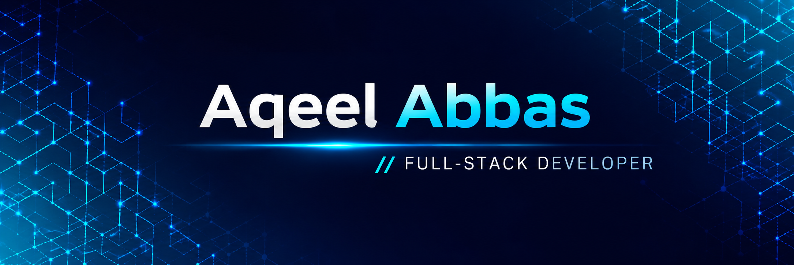
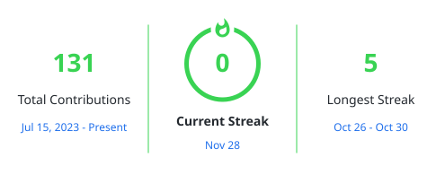

  

  

<h3 align="center">🧩 A Bit About Me</h3>

  ✨ I'm a Full-Stack Developer passionate about building responsive, scalable, and user-friendly web applications.

  💻 I work with MERN, JavaScript, PHP, MySQL, CSM (Wordpress/Shopify) and modern web technologies to develop practical solutions and engaging user experiences.

  🚀 I enjoy turning ideas into functional applications, writing clean code, and building solutions that solve real-world problems.

  🤝 Open to professional opportunities, collaborations, and interesting projects.

---

<h3 align="center">⚒ Things I Code With</h3>

  <h2>Frontend Development</h2>
  

  <h2>Backend Development & Database</h2>
  

    
    
    
  

  <h2>Tools & Platforms</h2>
  

    
    
    
    
  

---

<h3 align="center">🤝 How I Can Help You</h3>

  🚀 Build full-stack MERN applications with modern interfaces, powerful backend functionality and seamless database integration.

  ⚡ Turn your idea into a polished SaaS MVP with authentication, dashboards, database integration and real users in mind.

  💻 Develop dynamic PHP & MySQL applications, management systems, admin panels and custom business solutions.

  🌐 Design and develop professional WordPress websites using Elementor, WooCommerce and custom functionality.

  🛒 Build and customize Shopify stores with engaging storefronts, product pages and e-commerce features.

  💳 Set up payment gateways and subscription systems so you can start charging users without worrying about the tech.

  🐛 Fix bugs, refactor messy code, add new features and improve existing websites and applications.

---

<h3 align="center">📂 GitHub Stats</h3>

  <picture>
    <source
      media="(prefers-color-scheme: dark)"
      srcset="./profile/streak-dark.svg"
    />
    
  </picture>

---

<h3 align="center">📬 Let’s Connect</h3>

  
  
  <!--  -->
  <!--  -->
  <!--  -->
  

<!--
    src="https://skillicons.dev/icons?i=html,css,js,react,nextjs,tailwind,nodejs,express,postgres&amp;perline=10"
    alt="Frontend and Backend Technologies"
    src="https://skillicons.dev/icons?i=supabase,mongodb,mysql,redis,sentry,docker,nginx,vercel&amp;perline=8"
        src="https://skillicons.dev/icons?i=py,java,cpp,cs,figma,ps,ai,postman,vscode,git,github&amp;perline=13"

        
**Aqeel-Designer/Aqeel-Designer** is a ✨ _special_ ✨ repository because its `README.md` (this file) appears on your GitHub profile.

Here are some ideas to get you started:

- 🔭 I’m currently working on ...
- 🌱 I’m currently learning ...
- 👯 I’m looking to collaborate on ...
- 🤔 I’m looking for help with ...
- 💬 Ask me about ...
- 📫 How to reach me: ...
- 😄 Pronouns: ...
- ⚡ Fun fact: ...
-->
